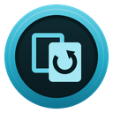
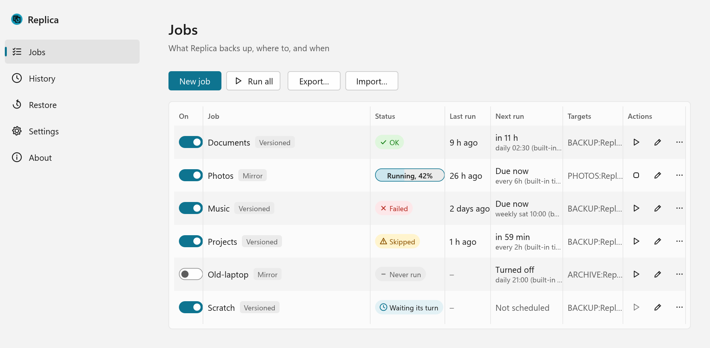

<p align="center"></p>

# Replica

[](https://github.com/Suremise/replica/actions/workflows/ci.yml)
[](LICENSE)

**Versioned backups for Windows that run by themselves, and tell you when they didn't.**

<picture>
  <source media="(prefers-color-scheme: dark)" srcset="docs/screenshots/jobs-dark.png">
  
</picture>

Replica backs up your folders to an external drive or a NAS share on a schedule. Each backup is a
snapshot you can go back to, so a file you deleted, overwrote or lost to ransomware last Tuesday
is still there. It runs from the tray, from Windows Task Scheduler if you like, or from the
command line, and every run ends with a clear result: done, partly done, skipped (the drive
wasn't plugged in) or failed, and why.

Replica is free and open source (MIT), for Windows 10 and 11. It drives
[restic](https://restic.net) for its snapshots and bundles a pinned copy, so there's nothing else
to install.

> **Status:** version 0.1.0, the first release: download it from
> [Releases](https://github.com/Suremise/replica/releases) ([Installing](#installing), below).
> It isn't code-signed yet, so check the download against its `SHA256SUMS.txt`
> ([SmartScreen and checksums](#smartscreen-and-checksums)).

**[The user guide](docs/user-guide.md)** covers setting up jobs, keeping the repository password
safe, restoring, a test restore routine, recovering without Replica and troubleshooting.

## Versioned backups, not a mirror

A mirror (an exact copy of a folder) copies your mistakes too: delete a file, and the next run
deletes the copy. Encrypt it with ransomware, and the copy is encrypted too. A mirror is only as
good as the moment before something went wrong, and you rarely notice in time.

So Replica's jobs are **versioned** by default. Each run adds a snapshot to a
[restic](https://restic.net) repository on the target: encrypted, deduplicated (unchanged files
take no extra space) and kept as long as the job's retention says, such as 7 daily, 4 weekly and 6
monthly. You can restore any file or folder from any snapshot that's kept.

A **mirror** job is still there for when you want a plain copy you can open in Explorer, such as
photos on a second drive. It must be asked for, by setting `mirror_deletes_confirmed = true`, and
it stops without deleting anything if a run would delete more than a set share of the target's
files (30% by default), as when a source was emptied by mistake.

## Quick start

1. **Install Replica** (see [Installing](#installing)), or build it from source (see
   [Building from source](#building-from-source)).
2. **Set up a job** in the window (**Jobs > Add job**, from the tray icon), or in `settings.toml`,
   in `%APPDATA%\Replica\` (or beside the exe for a portable copy). [docs/settings.example.toml](docs/settings.example.toml) documents every key; the
   [job model](#jobs) below shows the short version.
3. **Set up its target.** The window does this when you save the job. For a job set up in the
   file:

   ```
   replica init documents
   ```

   For a versioned job, this makes the repository and its password. The password is shown once:
   **save a copy** (see [below](#the-repository-password)), then type `saved` (in the window,
   click **I've saved a copy**).
4. **Run it:**

   ```
   replica run documents
   ```

5. **Restore from it:**

   ```
   replica snapshots documents
   replica restore documents latest "C:\Users\me\Documents\report.docx" --to C:\Restored
   ```

   A restore always goes to a new or empty folder, never over your files, unless you ask for that
   with `--overwrite`.

Every command and option is in [docs/cli.md](docs/cli.md).

## Jobs

A job is what to back up (its sources), where to (one or more targets) and how (versioned or
mirror), with an optional schedule. Two examples:

```toml
[[jobs]]
name = "documents"
mode = "versioned"            # the default
schedule = "daily 21:00"

[jobs.retention]
daily = 7
weekly = 4
monthly = 6

[[jobs.sources]]
path = 'C:\Users\me\Documents'
exclude = ["*.tmp", "node_modules"]

# A drive is found by its volume ID or label, whatever letter Windows gives it today.
[[jobs.targets]]
kind = "drive"
name = "Backup drive"
label = "BACKUP"
path = 'Replica\documents'

# A NAS share; its login is in Windows Credential Manager, never in this file.
[[jobs.targets]]
kind = "unc"
name = "NAS"
path = '\\nas\backup\replica\documents'
credential = "replica-nas"

[[jobs]]
name = "photos-copy"
mode = "mirror"
mirror_deletes_confirmed = true
schedule = "weekly sun 10:00"

[[jobs.sources]]
path = 'D:\Photos'

[[jobs.targets]]
kind = "drive"
label = "PHOTOS"
path = 'Photos'
```

A job can also have **before steps**, such as a consistent snapshot of a live SQLite database
(Replica copies it safely and backs up the copy, never the file mid-write) or a command, and
**after steps**, such as a command or a regular `restic check` of the repository. A target that
isn't there (the drive is unplugged, the NAS is off) is **skipped**, not failed, and the next run
catches up.

## Schedules

A job's `schedule` is `daily 02:30`, `weekly mon,thu 21:00`, `every 6h` or `every 90m`; without
one, it runs only when you ask.

- **The built-in timer (the default):** the tray app runs schedules while it's running. Turn on
  **Start with Windows** in its menu, and it always is.
- **Windows Task Scheduler (optional, off by default):** set `schedule_mode = "task-scheduler"`,
  and Replica makes a per-user task for each scheduled job (no admin rights), so backups run even
  when the tray app isn't running, while you're logged on. `replica tasks list` shows them all,
  and `replica tasks enable|disable|remove` manages them. Turning the option off removes the tasks
  that are on; `replica tasks remove --all` removes any you'd turned off too.

The two never both run a job, and a job never runs twice at once.

The tray icon shows how things are: idle, running (with its progress in the tooltip), a red dot
when a run failed, and an amber dot when a job is overdue. A failure always notifies you; a
success notifies only if the job asks for it.

## The repository password

**Each versioned target's repository is encrypted with its own password. Lose it, and the backup
can't be read by anyone, Replica included.**

Replica makes the password when you set the target up, and keeps it in Windows Credential
Manager. That copy goes with the PC: if the PC dies, so does the password, unless you saved a
copy. So when `replica init` shows it, **save a copy somewhere else**, in a password manager or on
paper. `replica key show <job>` shows it again whenever you need it, and on a new PC
`replica key set <job>` (or **Enter a saved password…** in the job's editor) puts your copy back,
once it's checked against the backup.

### Recover without Replica

The backups are plain restic repositories. Each one has a `HOW-TO-RESTORE.txt` beside it (with no
secrets in it) that says how to restore with [restic](https://restic.net) alone: on another PC,
without Replica, all you need is the repository folder and its password.

## Use it from other tools

The command line is made for scripts and other apps. `replica run <job> --quiet` prints nothing
unless something goes wrong and exits with the run's result, so it suits another app's hooks,
such as a "run on close" setting. The exit codes are 0 ok, 1 failed, 2 partly done, 3 skipped and
4 a usage or settings error, and `--json` prints results for programs to read
([docs/cli-json.md](docs/cli-json.md)).

## Installing

Replica ships two ways, each with both exes (`replica.exe`, the command line, and
`replica-tray.exe`, the tray app), the bundled restic, the licence and the third-party notices:

- **The MSI**, installed per user, with no admin rights, to `%LOCALAPPDATA%\Programs\Replica`.
  Settings and history are kept in `%APPDATA%\Replica\`.
- **The portable zip** (`replica-<version>-portable.zip`): unzip it anywhere, such as a USB stick.
  Everything is kept beside the exes.

Each release on GitHub has `replica-<version>-x64.msi`, `replica-<version>-portable.zip` and
`SHA256SUMS.txt`.

**With the MSI:**

1. Download `replica-<version>-x64.msi` and check it (below).
2. Double-click it. It installs for you alone, with no admin rights and no questions, and
   starts the tray app, which then starts when you log on to Windows.
3. Open Replica from its icon in the notification area, or from the Start menu.

The MSI also adds `replica.exe` to your PATH, so `replica run documents --quiet` works from a new
terminal and from another app's hooks. To install without starting with Windows, run
`msiexec /i replica-<version>-x64.msi STARTWITHWINDOWS=0`; you can change it later in the tray
menu or in Settings. Uninstall it from Settings > Apps: that removes Replica's scheduled tasks
too, and keeps your settings, history and backups.

**Portable:**

1. Download `replica-<version>-portable.zip` and check it (below).
2. Unzip it into a folder of its own, on this PC or a USB stick.
3. Run `replica-tray.exe` (or `replica.exe` in a terminal). Settings, history and logs are kept
   in that folder; to remove Replica, delete it.

### SmartScreen and checksums

Replica isn't code-signed yet, so Windows SmartScreen may warn the first time you run the
installer or the exes ("Windows protected your PC"). Check the download first: compare its SHA-256
with the one in the release's `SHA256SUMS.txt`, in PowerShell

```
Get-FileHash .\replica-<version>-portable.zip -Algorithm SHA256
```

or, with `SHA256SUMS.txt` beside the downloads, in Git Bash or WSL

```
sha256sum -c SHA256SUMS.txt --ignore-missing
```

and if they match, choose **More info**, then **Run anyway**.

## Privacy

**No telemetry, ever.** Replica sends nothing anywhere, has no account and doesn't check for
updates. It connects to nothing but the targets you set up: your drives and your NAS shares.

## Licence

**MIT; every dependency is MIT or equally permissive; restic is bundled under BSD-2.**

Replica's own code is under the [MIT licence](LICENSE). Every Rust crate it's built from is MIT,
Apache-2.0, BSD, ISC, Zlib or similarly permissive, and the CI checks that with `cargo deny`.
The bundled restic exe is unmodified restic, under BSD-2-Clause; one Go module inside it is
MPL-2.0, which is fine to ship unmodified. Every licence, with links to the exact sources, is in
[THIRD-PARTY-NOTICES](THIRD-PARTY-NOTICES.txt), which ships with Replica. restic's part of it is
[third_party/restic/LICENSES.md](third_party/restic/LICENSES.md).

## Building from source

You need Windows 10 or 11, [Rust](https://rustup.rs) (the toolchain is pinned in
`rust-toolchain.toml`; rustup installs it on first use) and PowerShell 7.

```
git clone https://github.com/Suremise/replica
cd replica
pwsh scripts/fetch-restic.ps1      # the pinned restic, checked against its SHA-256
cargo build --release
```

The exes are in `target\release\`: `replica.exe` and `replica-tray.exe`. A debug build finds the
fetched restic in `third_party\restic\bin\`; a release build looks beside its exe, so copy
`restic.exe` there, or point `restic_path` in the settings at it.

`cargo test --workspace` runs the tests. [CONTRIBUTING.md](CONTRIBUTING.md) has the rest:
the checks, the code layout and how to add a string or a language.

## Contributing and security

- Contributions are welcome: see [CONTRIBUTING.md](CONTRIBUTING.md) and the
  [Code of Conduct](CODE_OF_CONDUCT.md).
- Found a security problem? Please report it privately, as [SECURITY.md](SECURITY.md) says, not in
  a public issue.
- What's changed: [CHANGELOG.md](CHANGELOG.md).

Replica is on GitHub at [github.com/Suremise/replica](https://github.com/Suremise/replica). Its
home page will be at surmise.it/tools/replica.
